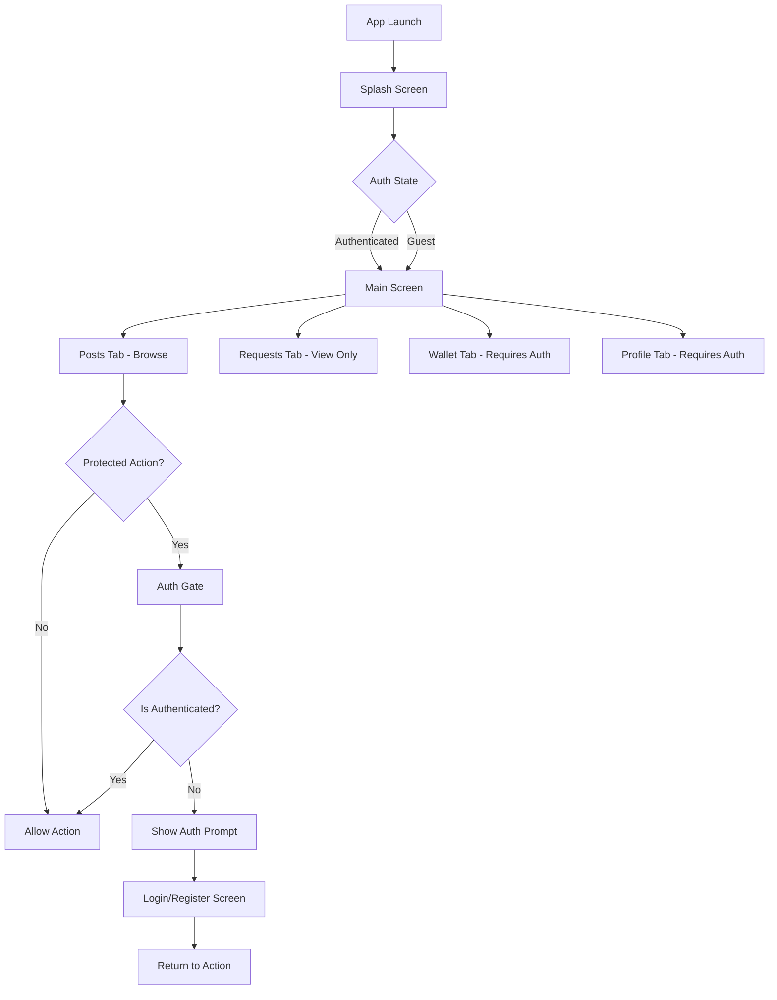
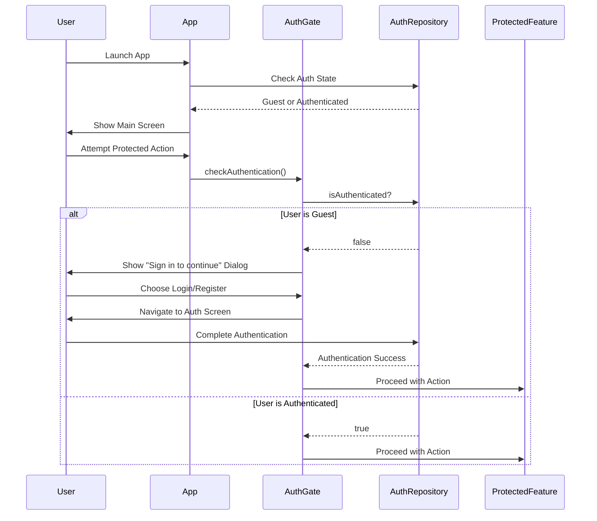

# Design Document: Guest Mode with Optional Authentication

## Overview

This feature enables users to browse the VaultWheels rideshare app as guests without requiring authentication, while enforcing authentication for protected actions (creating vehicles, accepting bookings, making bookings, creating posts). The design maintains security by requiring login/signup only when users attempt write operations, providing a frictionless browsing experience while protecting sensitive operations.

## Architecture



## Main Algorithm/Workflow



## Components and Interfaces

### Component 1: AuthGate

**Purpose**: Middleware that intercepts protected actions and enforces authentication requirements

**Interface**:
```dart
class AuthGate {
  /// Check if user is authenticated before allowing action
  /// Returns true if authenticated, false if guest (shows auth prompt)
  static Future<bool> requireAuth(
    BuildContext context, {
    required String actionName,
    VoidCallback? onAuthSuccess,
  });
  
  /// Show authentication prompt dialog
  static Future<void> showAuthPrompt(
    BuildContext context, {
    required String actionName,
    VoidCallback? onAuthSuccess,
  });
}
```

**Responsibilities**:
- Intercept protected action attempts
- Check authentication state via AuthRepository
- Display authentication prompt for guest users
- Navigate to login/register screens
- Return user to original action after successful authentication

### Component 2: AuthRepository (Enhanced)

**Purpose**: Manage authentication state with guest mode support

**Interface**:
```dart
class AuthRepository {
  /// Current authentication state
  ValueListenable<AuthUser?> get currentUserListenable;
  
  /// Check if user is authenticated (not guest)
  bool get isAuthenticated;
  
  /// Check if user is in guest mode
  bool get isGuestMode;
  
  /// Current user (null if guest)
  AuthUser? get currentUser;
  
  /// Enable guest mode (skip authentication)
  Future<void> enableGuestMode();
  
  /// Existing auth methods
  Future<AuthUser?> signInWithEmail({required String email, required String password});
  Future<AuthUser?> signUpWithEmail({required String email, required String password, String? profileName});
  Future<void> logout();
}
```

**Responsibilities**:
- Track authentication state (authenticated vs guest)
- Provide guest mode flag
- Maintain existing authentication flows
- Notify listeners of auth state changes

### Component 3: SplashScreen (Modified)

**Purpose**: Initial screen that determines navigation path based on auth state

**Interface**:
```dart
class Splashscreen extends StatefulWidget {
  const Splashscreen({super.key});
  
  @override
  State<Splashscreen> createState() => _SplashscreenState();
}

class _SplashscreenState extends State<Splashscreen> {
  /// Determine initial route: always navigate to MainScreen
  /// (guest or authenticated)
  Future<void> _determineInitialRoute();
}
```

**Responsibilities**:
- Check authentication state on app launch
- Navigate to MainScreen for both guest and authenticated users
- Remove forced navigation to login screen

### Component 4: MainScreen (Modified)

**Purpose**: Main navigation hub with tab-based interface

**Interface**:
```dart
class MainScreen extends StatefulWidget {
  const MainScreen({super.key});
  
  @override
  State<MainScreen> createState() => _MainScreenState();
}

class _MainScreenState extends State<MainScreen> {
  /// Handle tab navigation with auth checks
  void _onTabTapped(int index);
  
  /// Check if tab requires authentication
  bool _isProtectedTab(int index);
}
```

**Responsibilities**:
- Display bottom navigation with 4 tabs
- Allow guest access to Posts tab (read-only browsing)
- Show auth prompt when guests tap Wallet or Profile tabs
- Allow Requests tab with limited guest functionality

### Component 5: Protected Action Widgets

**Purpose**: Wrap protected actions with authentication gates

**Interface**:
```dart
class ProtectedActionButton extends StatelessWidget {
  final String actionName;
  final VoidCallback onPressed;
  final Widget child;
  
  const ProtectedActionButton({
    required this.actionName,
    required this.onPressed,
    required this.child,
  });
  
  @override
  Widget build(BuildContext context);
}
```

**Responsibilities**:
- Wrap buttons/actions that require authentication
- Trigger AuthGate check before executing action
- Display auth prompt if user is guest

## Data Models

### Model 1: AuthUser (Existing - No Changes)

```dart
class AuthUser {
  final String id;
  final String email;
  final String? profileName;
  final String? avatarUrl;
  final String? phone;

  const AuthUser({
    required this.id,
    required this.email,
    this.profileName,
    this.avatarUrl,
    this.phone,
  });
}
```

**Validation Rules**:
- id must be non-empty
- email must be valid email format

### Model 2: GuestSession (New)

```dart
class GuestSession {
  final String sessionId;
  final DateTime createdAt;
  final Map<String, dynamic> preferences;
  
  const GuestSession({
    required this.sessionId,
    required this.createdAt,
    this.preferences = const {},
  });
}
```

**Validation Rules**:
- sessionId must be unique UUID
- createdAt must be valid timestamp

## Key Functions with Formal Specifications

### Function 1: AuthGate.requireAuth()

```dart
static Future<bool> requireAuth(
  BuildContext context, {
  required String actionName,
  VoidCallback? onAuthSuccess,
})
```

**Preconditions:**
- `context` is a valid BuildContext
- `actionName` is a non-empty string describing the protected action

**Postconditions:**
- Returns `true` if user is authenticated
- Returns `false` if user is guest (after showing auth prompt)
- If authentication succeeds, `onAuthSuccess` callback is invoked
- Navigation state is preserved for return after authentication

**Loop Invariants:** N/A

### Function 2: AuthGate.showAuthPrompt()

```dart
static Future<void> showAuthPrompt(
  BuildContext context, {
  required String actionName,
  VoidCallback? onAuthSuccess,
})
```

**Preconditions:**
- `context` is a valid BuildContext
- `actionName` is a non-empty string

**Postconditions:**
- Dialog is displayed with authentication options
- User can choose "Login" or "Sign Up"
- User can dismiss dialog to cancel action
- On successful authentication, returns to original screen

**Loop Invariants:** N/A

### Function 3: AuthRepository.enableGuestMode()

```dart
Future<void> enableGuestMode()
```

**Preconditions:**
- AuthRepository is initialized

**Postconditions:**
- `isGuestMode` returns `true`
- `isAuthenticated` returns `false`
- `currentUser` is `null`
- Guest session is created with unique ID
- Listeners are notified of state change

**Loop Invariants:** N/A

### Function 4: _isProtectedAction()

```dart
bool _isProtectedAction(String action)
```

**Preconditions:**
- `action` is a non-empty string identifier

**Postconditions:**
- Returns `true` if action requires authentication
- Returns `false` if action is allowed for guests
- Decision is based on predefined protected action list

**Loop Invariants:** N/A

## Algorithmic Pseudocode

### Main Authentication Gate Algorithm

```dart
// Algorithm: Check Authentication Before Protected Action
// Input: context (BuildContext), actionName (String), onAuthSuccess (callback)
// Output: bool (true if authenticated, false if guest)

Future<bool> requireAuth(
  BuildContext context, {
  required String actionName,
  VoidCallback? onAuthSuccess,
}) async {
  // Step 1: Check current authentication state
  final authRepo = AuthRepository.instance;
  final isAuthenticated = authRepo.isAuthenticated;
  
  // Step 2: If authenticated, allow action immediately
  if (isAuthenticated) {
    return true;
  }
  
  // Step 3: User is guest - show authentication prompt
  await showAuthPrompt(
    context,
    actionName: actionName,
    onAuthSuccess: onAuthSuccess,
  );
  
  // Step 4: Return false to indicate action was blocked
  // (actual action will be retried after successful auth via callback)
  return false;
}
```

**Preconditions:**
- AuthRepository is initialized and accessible
- BuildContext is valid and mounted

**Postconditions:**
- Authenticated users proceed with action
- Guest users see authentication prompt
- No action is executed for guests until authentication completes

**Loop Invariants:** N/A

### Guest Mode Initialization Algorithm

```dart
// Algorithm: Initialize Guest Mode on App Launch
// Input: None
// Output: Navigation to MainScreen

Future<void> initializeGuestMode() async {
  // Step 1: Check if user has existing authentication
  final authRepo = AuthRepository.instance;
  await authRepo.init();
  
  // Step 2: If no authenticated user, enable guest mode
  if (!authRepo.isAuthenticated) {
    await authRepo.enableGuestMode();
  }
  
  // Step 3: Navigate to MainScreen (works for both guest and authenticated)
  // No forced redirect to login screen
  Navigator.pushReplacementNamed(context, '/main');
}
```

**Preconditions:**
- App has completed initialization
- AuthRepository is available

**Postconditions:**
- Guest mode is enabled if no authenticated user exists
- User is navigated to MainScreen
- Authentication state is properly tracked

**Loop Invariants:** N/A

### Protected Action Check Algorithm

```dart
// Algorithm: Determine if Action Requires Authentication
// Input: actionName (String)
// Output: bool (true if protected, false if public)

bool isProtectedAction(String actionName) {
  // Define list of protected actions
  const protectedActions = {
    'create_vehicle',
    'create_post',
    'book_ride',
    'accept_booking',
    'view_wallet',
    'view_profile',
    'edit_profile',
    'add_payment_method',
    'create_slot',
  };
  
  // Check if action is in protected list
  return protectedActions.contains(actionName);
}
```

**Preconditions:**
- `actionName` is a valid string identifier

**Postconditions:**
- Returns boolean indicating protection status
- Decision is deterministic based on action name

**Loop Invariants:** N/A

## Example Usage

```dart
// Example 1: Protecting a button action
class CreatePostButton extends StatelessWidget {
  @override
  Widget build(BuildContext context) {
    return ElevatedButton(
      onPressed: () async {
        // Check authentication before allowing post creation
        final canProceed = await AuthGate.requireAuth(
          context,
          actionName: 'create_post',
          onAuthSuccess: () {
            // Navigate to create post screen after successful auth
            Navigator.pushNamed(context, '/create-post');
          },
        );
        
        if (canProceed) {
          // User is authenticated, proceed immediately
          Navigator.pushNamed(context, '/create-post');
        }
        // If not authenticated, auth prompt is shown automatically
      },
      child: Text('Create Post'),
    );
  }
}

// Example 2: Protecting tab navigation
void _onTabTapped(int index) {
  // Wallet tab (index 2) and Profile tab (index 3) require auth
  if (index == 2 || index == 3) {
    AuthGate.requireAuth(
      context,
      actionName: index == 2 ? 'view_wallet' : 'view_profile',
      onAuthSuccess: () {
        setState(() {
          _currentIndex = index;
        });
      },
    );
  } else {
    // Posts and Requests tabs are accessible to guests
    setState(() {
      _currentIndex = index;
    });
  }
}

// Example 3: Modified splash screen navigation
class _SplashscreenState extends State<Splashscreen> {
  @override
  void initState() {
    super.initState();
    
    Future.delayed(const Duration(seconds: 1), () async {
      if (!mounted) return;
      
      // Enable guest mode if not authenticated
      if (!AuthRepository.instance.isAuthenticated) {
        await AuthRepository.instance.enableGuestMode();
      }
      
      // Always navigate to main screen (guest or authenticated)
      Navigator.pushReplacementNamed(context, '/main');
    });
  }
}

// Example 4: Auth prompt dialog
Future<void> showAuthPrompt(
  BuildContext context, {
  required String actionName,
  VoidCallback? onAuthSuccess,
}) async {
  return showDialog(
    context: context,
    builder: (context) => AlertDialog(
      title: Text('Sign in to continue'),
      content: Text('You need to sign in to $actionName'),
      actions: [
        TextButton(
          onPressed: () => Navigator.pop(context),
          child: Text('Cancel'),
        ),
        TextButton(
          onPressed: () {
            Navigator.pop(context);
            Navigator.pushNamed(context, '/login').then((_) {
              if (AuthRepository.instance.isAuthenticated) {
                onAuthSuccess?.call();
              }
            });
          },
          child: Text('Login'),
        ),
        ElevatedButton(
          onPressed: () {
            Navigator.pop(context);
            Navigator.pushNamed(context, '/register').then((_) {
              if (AuthRepository.instance.isAuthenticated) {
                onAuthSuccess?.call();
              }
            });
          },
          child: Text('Sign Up'),
        ),
      ],
    ),
  );
}
```

## Correctness Properties

### Property 1: Authentication Enforcement
**For all protected actions A, if user U is in guest mode, then A cannot be executed until U authenticates**

```dart
// Property test
assert(
  forAll(protectedActions, (action) {
    if (AuthRepository.instance.isGuestMode) {
      return !canExecute(action);
    }
    return true;
  })
);
```

### Property 2: Guest Browsing Access
**For all public views V, guest users can access V without authentication**

```dart
// Property test
assert(
  forAll(publicViews, (view) {
    return canAccess(view, guestUser: true);
  })
);
```

### Property 3: Authentication State Consistency
**If user U completes authentication, then isAuthenticated returns true and isGuestMode returns false**

```dart
// Property test
void testAuthStateConsistency() {
  final authRepo = AuthRepository.instance;
  
  // After successful authentication
  authRepo.signInWithEmail(email: 'test@example.com', password: 'password');
  
  assert(authRepo.isAuthenticated == true);
  assert(authRepo.isGuestMode == false);
  assert(authRepo.currentUser != null);
}
```

### Property 4: Action Retry After Authentication
**If guest user G attempts protected action A and then authenticates, then A can be executed after authentication completes**

```dart
// Property test
void testActionRetryAfterAuth() async {
  // Guest attempts protected action
  final canProceed = await AuthGate.requireAuth(
    context,
    actionName: 'create_post',
    onAuthSuccess: () {
      // This callback should be invoked after successful auth
      assert(AuthRepository.instance.isAuthenticated);
      // Action can now proceed
    },
  );
  
  // Initially blocked for guest
  assert(canProceed == false);
}
```

### Property 5: No Data Loss on Auth Prompt
**If user U is viewing content C and triggers auth prompt, then C remains accessible after authentication**

```dart
// Property test
void testNoDataLossOnAuthPrompt() {
  final currentRoute = Navigator.of(context).currentRoute;
  
  // Trigger auth prompt
  AuthGate.requireAuth(context, actionName: 'test_action');
  
  // After authentication, user should return to same route
  assert(Navigator.of(context).currentRoute == currentRoute);
}
```

## Error Handling

### Error Scenario 1: Authentication Fails During Protected Action

**Condition**: User attempts to authenticate from auth prompt but authentication fails (wrong credentials, network error)

**Response**: 
- Display error message from AuthRepository
- Keep auth prompt open or return to previous screen
- Do not execute protected action
- Allow user to retry authentication

**Recovery**: 
- User can retry with correct credentials
- User can cancel and return to browsing as guest
- Error state is cleared on successful authentication

### Error Scenario 2: Network Failure During Guest Session

**Condition**: Guest user is browsing and network connection is lost

**Response**:
- Allow continued browsing of cached content
- Display offline indicator
- Queue protected actions for retry when online
- Show appropriate error messages for actions requiring network

**Recovery**:
- Automatically retry when connection is restored
- Sync any queued actions
- Update UI to reflect online status

### Error Scenario 3: Auth State Desynchronization

**Condition**: AuthRepository state becomes inconsistent (e.g., Firebase auth succeeds but Supabase sync fails)

**Response**:
- Log error for debugging
- Attempt to resync auth state
- Fall back to guest mode if sync fails
- Display user-friendly error message

**Recovery**:
- Retry sync on next app launch
- Provide manual "Refresh" option in profile
- Clear local auth cache and re-authenticate if needed

### Error Scenario 4: User Cancels Auth Prompt

**Condition**: Guest user triggers protected action, sees auth prompt, and cancels

**Response**:
- Close auth prompt dialog
- Return to previous screen
- Do not execute protected action
- No error message (user intentionally cancelled)

**Recovery**:
- User remains in guest mode
- Can retry action later
- No state changes

## Testing Strategy

### Unit Testing Approach

Test individual components in isolation:

1. **AuthGate Tests**
   - Test `requireAuth()` returns true for authenticated users
   - Test `requireAuth()` returns false for guest users
   - Test `showAuthPrompt()` displays correct dialog
   - Test callback invocation after successful authentication

2. **AuthRepository Tests**
   - Test `enableGuestMode()` sets correct state
   - Test `isGuestMode` flag accuracy
   - Test `isAuthenticated` flag accuracy
   - Test state transitions (guest → authenticated → guest)

3. **Protected Action Tests**
   - Test each protected action is properly gated
   - Test guest users cannot execute protected actions
   - Test authenticated users can execute protected actions

### Property-Based Testing Approach

Use property-based testing to verify invariants across many scenarios:

**Property Test Library**: Use `flutter_test` with custom property generators

1. **Authentication State Properties**
   - Property: `isAuthenticated` and `isGuestMode` are mutually exclusive
   - Property: After successful auth, user is never in guest mode
   - Property: After logout, user is always in guest mode

2. **Action Protection Properties**
   - Property: All protected actions require authentication
   - Property: No public action requires authentication
   - Property: Action execution state is consistent with auth state

3. **Navigation Properties**
   - Property: Guest users can always access Posts tab
   - Property: Authenticated users can access all tabs
   - Property: Auth prompt always leads to login or register screen

### Integration Testing Approach

Test complete user flows:

1. **Guest Browsing Flow**
   - Launch app → Browse posts → View details → Attempt booking → See auth prompt

2. **Authentication Flow**
   - Guest mode → Trigger protected action → Login → Return to action → Execute action

3. **Tab Navigation Flow**
   - Guest taps Wallet tab → Auth prompt → Register → Access wallet

4. **Post Creation Flow**
   - Guest taps "Create Post" → Auth prompt → Login → Create post screen → Submit post

## Performance Considerations

1. **Lazy Authentication Check**: Only check authentication when protected action is triggered, not on every screen render

2. **Cached Auth State**: Cache authentication state in memory to avoid repeated Firebase/Supabase queries

3. **Optimistic UI Updates**: Show UI immediately for public actions without waiting for auth check

4. **Minimal Guest Session Overhead**: Guest session should have minimal memory footprint (just session ID and timestamp)

5. **Fast Auth Prompt**: Auth prompt dialog should appear instantly (<100ms) when triggered

## Security Considerations

1. **Server-Side Validation**: All protected actions must be validated on the backend (Supabase RLS policies) - client-side auth gate is UX only

2. **No Sensitive Data in Guest Mode**: Guest sessions should not have access to any user-specific data (bookings, wallet, profile)

3. **Session Expiration**: Guest sessions should expire after reasonable period (e.g., 24 hours) to prevent abuse

4. **Rate Limiting**: Apply rate limiting to prevent guests from spamming protected action attempts

5. **Secure Token Storage**: Authenticated user tokens must be stored securely (Flutter secure storage)

6. **Auth State Verification**: Verify auth state on critical operations, not just on UI layer

## Dependencies

1. **Firebase Auth**: Existing authentication provider (no changes required)
2. **Supabase**: Backend database with Row Level Security policies
3. **shared_preferences**: Store guest session data locally
4. **flutter_secure_storage**: Store authentication tokens securely
5. **provider** or **riverpod**: State management for auth state (optional, can use existing ValueNotifier)

## Implementation Notes

1. **Backward Compatibility**: Existing authenticated users should not be affected by guest mode changes

2. **Migration Path**: No database migration required - guest mode is client-side only

3. **Feature Flag**: Consider adding feature flag to enable/disable guest mode for gradual rollout

4. **Analytics**: Track guest user behavior (browsing patterns, auth conversion rate, most common protected actions triggered)

5. **A/B Testing**: Consider A/B testing different auth prompt designs to optimize conversion rate
