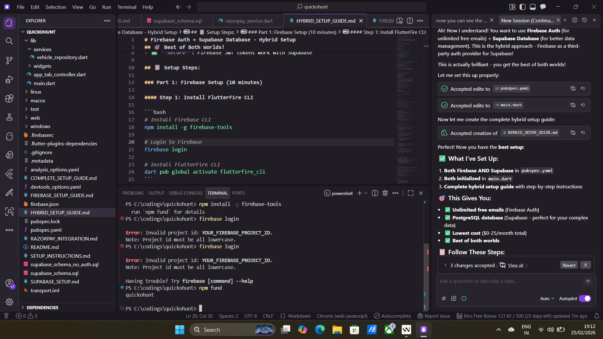

# Firebase Auth + Supabase Database - Hybrid Setup

## 🎯 Best of Both Worlds!

- ✅ **Firebase Auth**: Unlimited free emails
- ✅ **Supabase Database**: PostgreSQL, better for complex data
- ✅ **Lower costs**: Firebase auth is free, Supabase DB is cheaper
- ✅ **Secure**: Firebase JWT tokens work with Supabase

## 📋 Setup Steps:

### Part 1: Firebase Setup (10 minutes)

#### Step 1: Install FlutterFire CLI

```bash
# Install Firebase CLI
npm install -g firebase-tools

# Login to Firebase
firebase login

# Install FlutterFire CLI
dart pub global activate flutterfire_cli
```

#### Step 2: Create Firebase Project

1. Go to https://console.firebase.google.com/
2. Click "Add project"
3. Name: `quickohunt`
4. Disable Google Analytics (optional)
5. Click "Create project"

#### Step 3: Configure Flutter App

```bash
flutterfire configure
```

Select your project and all platforms (android, ios, web, windows)

#### Step 4: Enable Firebase Authentication

1. In Firebase Console → Authentication
2. Click "Get started"
3. Enable "Email/Password"
4. (Optional) Enable "Google" sign-in

#### Step 5: Get Firebase Project ID

1. In Firebase Console → Project Settings (gear icon)
2. Copy your "Project ID" (e.g., `quickohunt-12345`)
3. Save it - you'll need it for Supabase

---

### Part 2: Supabase Setup (10 minutes)

#### Step 1: Create Supabase Project

1. Go to https://supabase.com/
2. Create new project
3. Name: `quickohunt`
4. Region: Mumbai
5. Wait for provisioning

#### Step 2: Configure Firebase as Third-Party Auth

1. In Supabase Dashboard → Authentication → Providers
2. Scroll down to "Third-party Auth Providers"
3. Click "Add Provider" → Select "Firebase Auth"
4. Enter your Firebase Project ID from Part 1, Step 5
5. Click "Save"

#### Step 3: Run Database Schema

1. Go to SQL Editor
2. Copy content from `supabase_schema.sql`
3. Paste and Run
4. Verify tables are created

#### Step 4: Get Supabase Credentials

1. Settings → API
2. Copy:
   - Project URL
   - anon public key
3. Add to `lib/config/supabase_config.dart`

---

### Part 3: Install Dependencies (2 minutes)

```bash
flutter pub get
```

---

## 🔄 How It Works:

```
1. User signs up with email
   ↓
2. Firebase Auth creates account (free unlimited emails!)
   ↓
3. Firebase generates JWT token
   ↓
4. Your app sends JWT to Supabase
   ↓
5. Supabase verifies JWT (trusts Firebase)
   ↓
6. User can access Supabase database
```

---

## 💰 Cost Comparison:

### This Hybrid Approach:
- Firebase Auth: **FREE** (unlimited)
- Supabase DB: **$0-25/month** (free tier → Pro)
- **Total: $0-25/month**

### Pure Firebase:
- Firebase Auth: FREE
- Firestore: **$50-200/month** (with traffic)
- **Total: $50-200/month**

### Pure Supabase:
- Supabase Auth: Limited emails (need custom SMTP)
- Supabase DB: $0-25/month
- **Total: $0-25/month + SMTP costs**

**Winner: Hybrid approach! 🏆**

---

## 📝 Authentication Flow Code:

```dart
import 'package:firebase_auth/firebase_auth.dart';

// Sign up with email
Future<void> signUp(String email, String password) async {
  // 1. Create Firebase user
  final credential = await FirebaseAuth.instance
      .createUserWithEmailAndPassword(
    email: email,
    password: password,
  );
  
  // 2. Get Firebase JWT token
  final idToken = await credential.user?.getIdToken();
  
  // 3. Sign in to Supabase with Firebase token
  await supabase.auth.signInWithIdToken(
    provider: OAuthProvider.firebase,
    idToken: idToken!,
  );
  
  // 4. Now you can use Supabase database!
  await supabase.from('users').insert({
    'id': credential.user!.uid,
    'email': email,
    'name': 'User Name',
  });
}

// Sign in with email
Future<void> signIn(String email, String password) async {
  // 1. Sign in to Firebase
  final credential = await FirebaseAuth.instance
      .signInWithEmailAndPassword(
    email: email,
    password: password,
  );
  
  // 2. Get Firebase JWT token
  final idToken = await credential.user?.getIdToken();
  
  // 3. Sign in to Supabase with Firebase token
  await supabase.auth.signInWithIdToken(
    provider: OAuthProvider.firebase,
    idToken: idToken!,
  );
}
```

---

## ✅ Verification Checklist:

- [ ] Firebase project created
- [ ] FlutterFire configured (`firebase_options.dart` exists)
- [ ] Firebase Email auth enabled
- [ ] Supabase project created
- [ ] Firebase added as third-party provider in Supabase
- [ ] Supabase schema run successfully
- [ ] Supabase credentials added to config file
- [ ] `flutter pub get` completed
- [ ] App runs without errors

---

## 🐛 Troubleshooting:

**Error: "Invalid JWT"**
- Make sure you added Firebase Project ID correctly in Supabase
- Check that JWT token is being passed correctly

**Error: "Permission denied"**
- Supabase RLS policies check `auth.uid()`
- Make sure you're signed in to both Firebase AND Supabase

**Firebase emails not sending**
- Check spam folder
- Firebase emails are unlimited and free!

**Supabase connection fails**
- Verify URL and anon key are correct
- Check internet connection

---

## 🎯 What's Next?

After setup:

1. ✅ Test email signup/login
2. ✅ Migrate repositories to Supabase
3. ✅ Add real-time subscriptions
4. ✅ Set up Razorpay webhooks
5. ✅ Deploy!

---

## 📁 Files You Need:

- ✅ `lib/config/supabase_config.dart` - Supabase credentials
- ✅ `lib/firebase_options.dart` - Auto-generated by FlutterFire
- ✅ `supabase_schema.sql` - Database schema
- ✅ `pubspec.yaml` - Updated with both Firebase and Supabase

---

## ✨ Summary:

This hybrid approach gives you:
- Unlimited free authentication emails (Firebase)
- Powerful PostgreSQL database (Supabase)
- Lower costs than pure Firebase
- Better data management than pure Supabase Auth

**Total setup time: ~25 minutes**

Let me know when you're done and I'll help you integrate the authentication flow!
