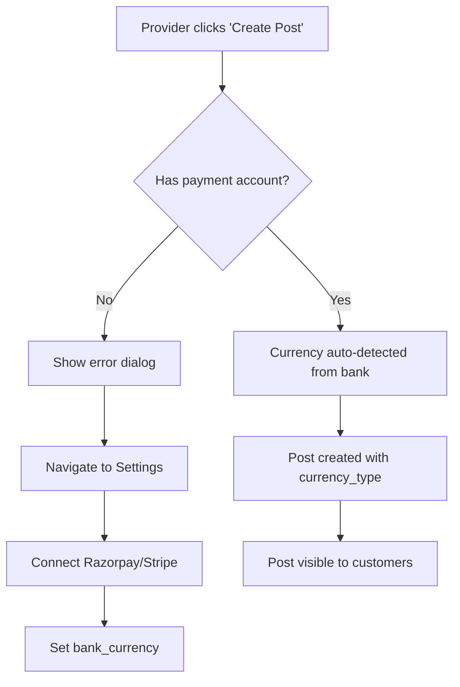
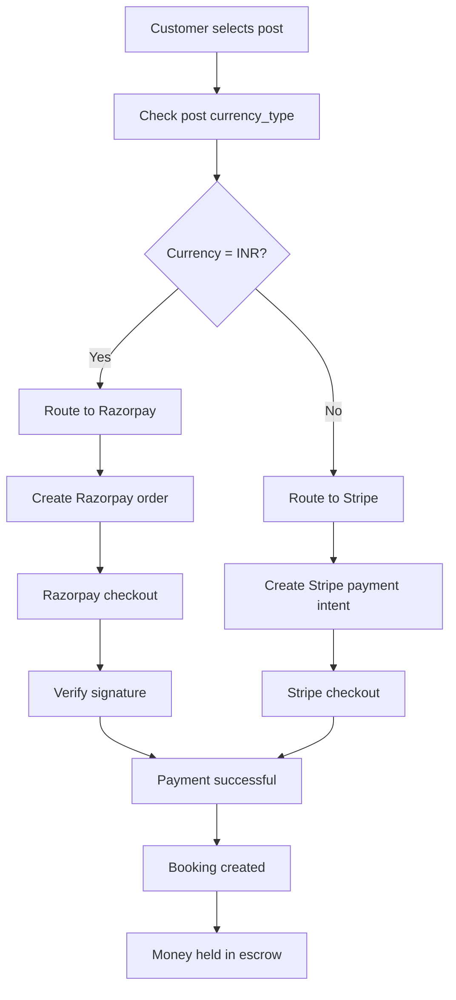

# Payment System Implementation Guide

## Overview
This guide documents the complete payment system implementation including provider payment validation, currency auto-detection, and payment flow.

---

## 🎯 Key Features Implemented

### 1. **Mandatory Payment Provider Connection**
- ✅ Provider posts REQUIRE payment account connection
- ✅ Customer posts do NOT require payment account (they pay, but don't receive)
- ✅ Validation blocks post creation until payment account is connected

### 2. **Currency Auto-Detection**
- ✅ Currency is auto-detected from user's **bank account**
- ✅ Uses `bank_currency` field from `profiles_private` table
- ✅ Fallback: Razorpay → INR, Stripe → USD

### 3. **Payment Flow**
- ✅ Razorpay for India (INR)
- ✅ Stripe for International (USD, GBP, EUR, etc.)
- ✅ Escrow support for customer posts
- ✅ Payment verification via Firebase Functions

---

## 📊 Database Schema

### Posts Table - Currency Type Column

```sql
-- Add currency_type column to posts table
ALTER TABLE posts 
ADD COLUMN IF NOT EXISTS currency_type TEXT DEFAULT 'INR';

COMMENT ON COLUMN posts.currency_type IS 'Currency code for this post, auto-detected from provider''s bank account';
```

**How it works:**
- When a provider creates a post, `currency_type` is set from their `bank_currency`
- If `bank_currency` is null, fallback to payment provider (Razorpay=INR, Stripe=USD)
- Default is INR for backward compatibility

---

## 💻 Code Implementation

### 1. Payment Provider Validation

**Location:** `lib/screens/add_flow/create_post_screen.dart`

**Function:** `_postSlot()`

```dart
// For provider posts (not customer posts)
if (!widget.isUserMode) {
  final currentUser = ProfileRepository.instance.profile.value;
  
  // Check payment provider connection
  final hasPaymentProvider = currentUser.paymentProvider != null && 
      currentUser.paymentProvider!.isNotEmpty;
  
  final hasStripe = currentUser.stripeAccountId != null && 
      currentUser.stripeAccountId!.isNotEmpty;
  
  final hasRazorpay = currentUser.razorpayAccountId != null && 
      currentUser.razorpayAccountId!.isNotEmpty;

  // Block post creation if no payment account
  if (!hasPaymentProvider || (!hasStripe && !hasRazorpay)) {
    // Show error dialog and navigate to settings
    return;
  }
}
```

**Behavior:**
- ✅ **Provider posts:** MUST have payment account → blocked until connected
- ✅ **Customer posts:** Can create without payment account → they pay on booking

---

### 2. Currency Auto-Detection

**Location:** `lib/screens/add_flow/create_post_screen.dart`

**Function:** `_determineCurrencyType()`

```dart
String _determineCurrencyType() {
  final currentUser = ProfileRepository.instance.profile.value;

  // Priority 1: Use bank account currency
  final bankCurrency = currentUser.bankCurrency;
  if (bankCurrency != null && bankCurrency.isNotEmpty) {
    return bankCurrency.toUpperCase(); // INR, USD, GBP, EUR
  }

  // Priority 2: Fallback to payment provider
  final paymentProvider = currentUser.paymentProvider;
  if (paymentProvider == 'razorpay') {
    return 'INR'; // Razorpay only supports INR
  } else if (paymentProvider == 'stripe') {
    return 'USD'; // Stripe default
  }

  // Priority 3: Default to INR
  return 'INR';
}
```

**How Currency is Set:**
1. **Best:** From connected bank account (`bank_currency` field)
2. **Good:** From payment provider (Razorpay=INR, Stripe=USD)
3. **Fallback:** Default to INR

**Where it's used:**
```dart
final slot = Slot(
  // ... other fields
  currencyType: _determineCurrencyType(), // Auto-detect from bank
);
```

---

### 3. Payment Flow

**Location:** `lib/services/payment_service.dart`

**Function:** `processPayment()`

```dart
Future<Map<String, dynamic>?> processPayment({
  required int amountInPaise,
  required String currency,
  required String? countryCode,
  required String providerId,
  required String slotId,
  // ... other params
}) async {
  // Route by country code
  if (_isIndia(countryCode)) {
    // ── Razorpay path ──
    // 1. Create order
    final orderResult = await createOrder(amount: amountInPaise, currency: 'INR');
    
    // 2. Open Razorpay checkout
    final result = await RazorpayService.instance.processPayment(
      amountInPaise: amountInPaise,
      orderId: orderId,
      // ...
    );
    
    // 3. Verify signature
    final verification = await verifyPayment(
      razorpayOrderId: orderId,
      razorpayPaymentId: result['payment_id'],
      razorpaySignature: signature,
    );
    
    return result;
  } else {
    // ── Stripe path ──
    return await StripeService.instance.processPayment(
      amount: amountInPaise,
      currency: currency,
      providerId: providerId,
      // ...
    );
  }
}
```

**Payment Routing:**
- `countryCode == 'IN'` → Razorpay (INR)
- `countryCode != 'IN'` → Stripe (USD/GBP/EUR)

---

## 🔄 Complete User Flow

### Provider Creates Post



### Customer Books Service



---

## 🗂️ Database Fields

### profiles_private table
```sql
-- Payment provider fields
payment_provider TEXT,          -- 'razorpay' or 'stripe'
stripe_account_id TEXT,         -- Stripe Connect account ID
razorpay_account_id TEXT,       -- Razorpay contact ID
bank_currency TEXT,             -- Currency of connected bank (INR/USD/GBP/EUR)

-- Bank details (for Razorpay)
bank_account_holder TEXT,
bank_account_number TEXT,
bank_name TEXT,
bank_ifsc TEXT,
bank_account_type TEXT          -- 'savings' or 'current'
```

### posts table
```sql
-- Currency field
currency_type TEXT DEFAULT 'INR',  -- Auto-detected from provider's bank
```

---

## ✅ Testing Checklist

### Provider Setup
- [ ] Navigate to Profile → Settings
- [ ] Choose payment provider (Razorpay or Stripe)
- [ ] Connect bank account
- [ ] Verify `bank_currency` is set

### Post Creation
- [ ] Try to create post without payment account → should block
- [ ] Connect payment account
- [ ] Create post → currency auto-detected
- [ ] Verify post has correct `currency_type`

### Customer Booking
- [ ] Find post with INR currency
- [ ] Book slot → Razorpay checkout opens
- [ ] Complete payment → booking created
- [ ] Find post with USD currency
- [ ] Book slot → Stripe checkout opens
- [ ] Complete payment → booking created

### Payment Flow
- [ ] Test Razorpay payment (India)
- [ ] Test Stripe payment (International)
- [ ] Test escrow for customer posts
- [ ] Test payment verification
- [ ] Test payment failure handling

---

## 🚀 SQL Migration Commands

Run these in order:

### 1. Add currency_type column
```bash
psql -U postgres -d quickohunt -f add_currency_type_to_posts.sql
```

Or run directly:
```sql
ALTER TABLE posts ADD COLUMN IF NOT EXISTS currency_type TEXT DEFAULT 'INR';
```

### 2. Update existing posts
```sql
-- Update from bank_currency
UPDATE posts p
SET currency_type = COALESCE(
    (SELECT bank_currency FROM profiles_private WHERE id = p.profile_id),
    'INR'
)
WHERE p.currency_type IS NULL OR p.currency_type = '';

-- Fallback to payment_provider
UPDATE posts p
SET currency_type = CASE 
    WHEN (SELECT payment_provider FROM profiles_private WHERE id = p.profile_id) = 'razorpay' THEN 'INR'
    WHEN (SELECT payment_provider FROM profiles_private WHERE id = p.profile_id) = 'stripe' THEN 'USD'
    ELSE 'INR'
END
WHERE p.currency_type IS NULL OR p.currency_type = '';
```

---

## 📝 Important Notes

### 1. Currency Source Priority
1. **bank_currency** (best - accurate bank currency)
2. **payment_provider** (good - Razorpay=INR, Stripe=USD)
3. **Default** (fallback - INR)

### 2. Payment Provider vs Currency
- **Payment Provider:** Determines which gateway to use (Razorpay/Stripe)
- **Bank Currency:** Determines the actual currency for the post (INR/USD/GBP/EUR)
- **Example:** Provider with Stripe + UK bank → currency_type = 'GBP'

### 3. Customer Posts (isUserMode=true)
- Customers DON'T need payment account to create posts
- They pay on booking (escrow)
- Payment routing based on provider's currency_type

### 4. Provider Posts (isUserMode=false)
- Providers MUST have payment account
- Validation blocks post creation until connected
- Currency auto-detected from bank

---

## 🔧 Troubleshooting

### Issue: Post creation blocked even with payment account
**Solution:** Check that BOTH fields are set:
```dart
paymentProvider != null  // 'razorpay' or 'stripe'
stripeAccountId != null  // OR razorpayAccountId != null
```

### Issue: Wrong currency detected
**Solution:** Check priority:
1. Verify `bank_currency` is set correctly
2. Check `payment_provider` fallback
3. Ensure default to 'INR' works

### Issue: Payment routing to wrong gateway
**Solution:** Check `countryCode` extraction:
```dart
PaymentService.countryCodeFromLocation(slot.fromLocation)
```

---

## 📚 Related Files

### Frontend
- `lib/screens/add_flow/create_post_screen.dart` - Post creation + validation
- `lib/services/payment_service.dart` - Payment routing logic
- `lib/services/stripe_service.dart` - Stripe integration
- `lib/services/razorpay_service.dart` - Razorpay integration
- `lib/services/profile_repository.dart` - Profile data management
- `lib/widgets/booking_confirm_sheet.dart` - Booking payment flow

### Backend
- `functions/stripe-escrow.js` - Stripe payment intents
- `functions/razorpay-order.js` - Razorpay order creation
- `functions/razorpay-verify.js` - Payment verification

### Database
- `add_currency_type_to_posts.sql` - Add currency column
- `add_payment_provider_columns.sql` - Add payment fields to profiles

---

## 🎉 Summary

### What Works Now:

✅ **Provider Posts:**
- MUST connect payment account (Stripe/Razorpay)
- Currency auto-detected from bank account
- Post creation blocked until payment account connected

✅ **Customer Posts:**
- Can create without payment account
- Pay on booking (escrow)
- Money held until service completion

✅ **Payment Flow:**
- Razorpay for India (INR)
- Stripe for International (USD/GBP/EUR)
- Auto-routing based on currency
- Escrow support for customer posts

✅ **Currency System:**
- Auto-detected from bank account
- Fallback to payment provider
- Default to INR for backward compatibility

---

## 🔗 Next Steps

1. Run SQL migration to add `currency_type` column
2. Test provider post creation with/without payment account
3. Test currency auto-detection for different banks
4. Test payment flow for INR and USD
5. Deploy to production

---

**Last Updated:** July 7, 2026
**Version:** 1.0
